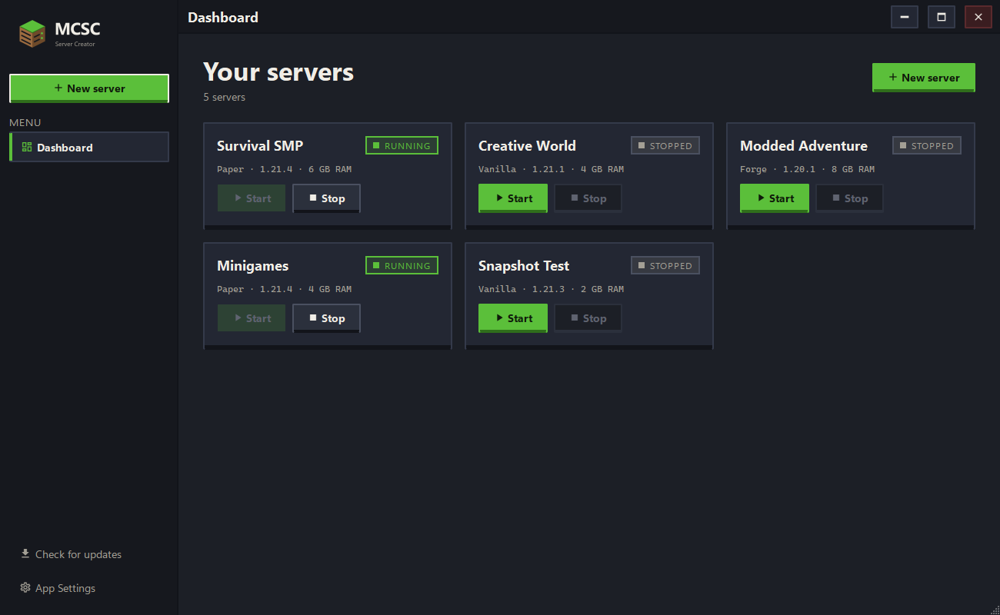
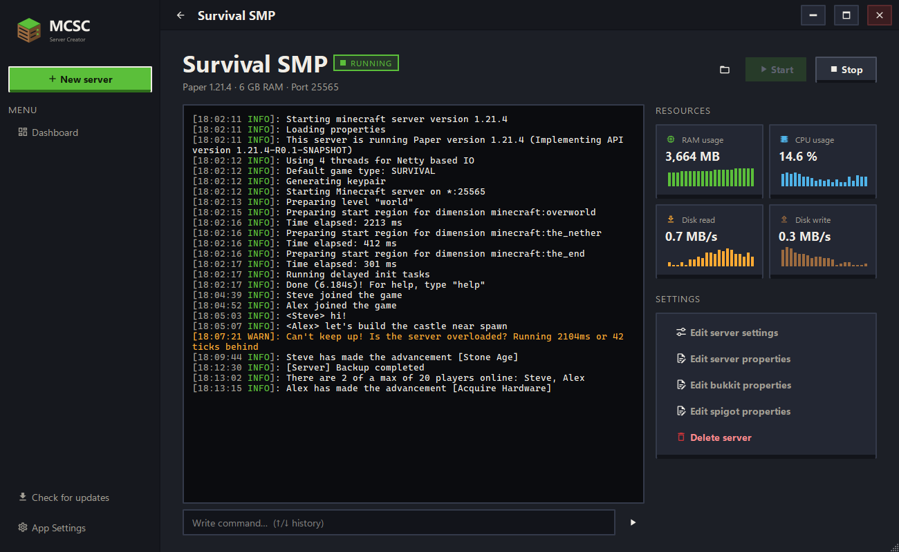
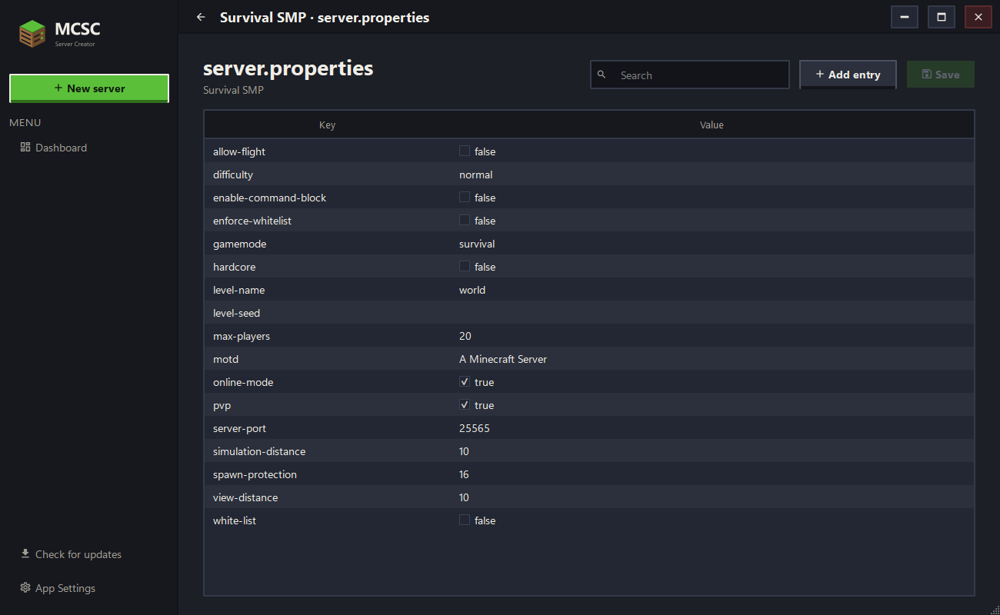
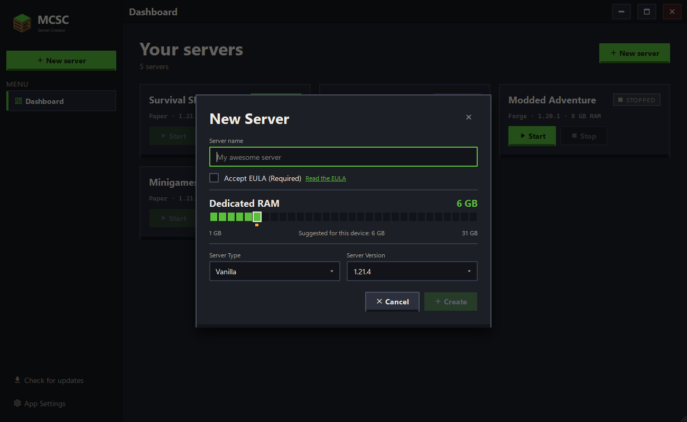

[](./LICENSE)


# MCSC - Minecraft Server Creator
MCSC is a user-friendly tool written in Python with a GUI that simplifies the process of creating and managing Minecraft servers. Whether you're a beginner or experienced, MCSC allows you to easily set up, run, and control multiple Minecraft servers from a single interface.
> **Warning**: MCSC is still in development, thus it may not be completely error free.

## Features
- **Create Multiple Servers**: Set up and manage multiple Minecraft servers from within the app.
- **Start/Stop Servers**: Easily start and stop your Minecraft servers directly from the GUI.
- **Console Interaction**: Read the console output in real-time and send commands to the Minecraft server console.
- **Edit server.properties**: Customize your Minecraft server settings by editing the `server.properties` file with a built-in editor.
- **User-Friendly GUI**: A simple and intuitive interface designed for both beginners and experienced users.
- **Manage Server Instances**: Keep track of all your servers in one place.

## Screenshots
| Server console and resources | Config editor |
| --- | --- |
|  |  |

| New server |
| --- |
|  |

## Installation
### Windows installer (no Python needed)
Download `mcsc-setup-<version>.exe` from the [latest release](https://github.com/ddavidel/minecraft-server-creator/releases/latest)
and run it. It installs MCSC with its own private Python, adds it to the Start menu and keeps
it up to date from the app. No admin rights are needed. Uninstall it from *Settings > Apps*:
your servers and settings are kept. Java is still required to run Minecraft servers.

### From PyPI
MCSC requires Python 3.12+ and Java.

Install it from PyPI and run it:
```bash
pip install minecraft-server-creator
mcsc
```

To run it from the source code:
1. Clone the repository:
`git clone https://github.com/ddavidel/minecraft-server-creator.git`

2. Navigate to the project folder and install it with its dependencies:
`pip install -e .`

3. Run the application with `mcsc` or `python scripts/start.py` (add `--debug` to log to the console).

## Project structure
- `src/mcsc_gui`: the desktop app (Qt/PySide6 interface, translations, settings, telemetry, updates).
- Server management (creating, running, monitoring and configuring servers) is provided by the
  [pymcsc](https://pypi.org/project/pymcsc/) library, imported as `mcsc`.

## Code signing policy
Free code signing provided by [SignPath.io](https://about.signpath.io/), certificate by
[SignPath Foundation](https://signpath.org/).

- Committers and reviewers: [repository members](https://github.com/ddavidel/minecraft-server-creator/graphs/contributors)
- Approvers: [ddavidel](https://github.com/ddavidel)

The Windows installer is built from this repository by GitHub Actions
(`.github/workflows/installer.yml`) and signed only after an approver confirms the release.

## Privacy policy
When it starts, MCSC sends an anonymous usage event to `mcscreator.altervista.org`. The event
holds a random client ID generated on first run, the event name, a timestamp and the app
version. It doesn't send personal data, server contents or files. It also checks PyPI for updates and downloads Minecraft server files when you create a
server. Nothing else is sent to other networked systems unless you ask for it.

## Upcoming Features
- **Support for more server types**: In the future updates, MCSC will support creating and managing many popular Minecraft server types.
- **Plugin and Mod Manager**: Easily manage plugins and mods.
